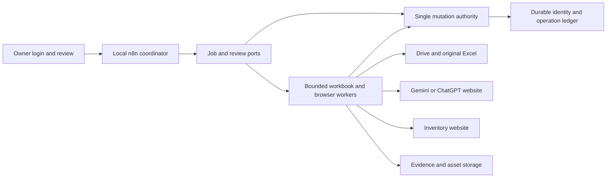

# Architecture spine

This is a proposed consistency design. `[ADOPTED]` identifies an owner-established constraint; `[PROPOSED]` identifies a mechanism selected for this draft. No runtime or technology version is claimed installed. The [data contract](../../../specs/spec-hbrand-inventory/data-contracts.md) defines shared semantics; this spine fixes ownership and divergence rules.

## Design paradigm

Pipes-and-filters stages use ports/adapters for Drive, original Excel, image websites and inventory. Local n8n coordinates durable stages; proposed local workers execute bounded jobs; one durable mutation authority owns catalogue identity and external-operation outcomes. n8n never infers a successful save from a worker timeout or an optimistic UI message.

## Invariants and rules

### AD-1 — One orchestration boundary [ADOPTED / PROPOSED]

- **Binds:** CAP-1 through CAP-13; coordinator and adapters.
- **Prevents:** Browser lifetime, workbook processing and successful-operation state being independently reinvented inside each n8n execution.
- **Rule:** Local n8n is the adopted coordinator. The proposed workers return evidence and operation references; shared state changes pass through the single mutation authority. Adapters cannot declare final outcomes without the evidence required by the shared contract.

### AD-2 — Variant and family identity [ADOPTED]

- **Binds:** CAP-2, CAP-3, CAP-4, CAP-10, CAP-11.
- **Prevents:** Parent SKU replacing source barcodes, unstable re-grouping, false design merges and invented colour/size pairs.
- **Rule:** Original barcode identifies the investigated variant; family identity owns one persistent SKU across confirmed colours/sizes. Clear duplicate checks only against a complete versioned index of the selected source manifest. Preserve observed membership, retain partial-scope uncertainty and recheck relevant existence/index evidence before external creation.

### AD-3 — Original evidence owns product facts [PROPOSED]

- **Binds:** CAP-1, CAP-4, CAP-5, CAP-7, CAP-9, CAP-13.
- **Prevents:** Generated photographs or normalized display fields overwriting original facts or source-to-picture associations.
- **Rule:** Retain immutable source observations and media/anchor relationships. Copy, prompts and translations consume versioned canonical facts. Generated assets are outputs and cannot introduce factual garment attributes.

### AD-4 — Single mutation and reservation owner [PROPOSED]

- **Binds:** CAP-3, CAP-9, CAP-11, CAP-12, CAP-13.
- **Prevents:** Concurrent jobs assigning two SKUs, updating one source simultaneously or creating duplicate target stock.
- **Rule:** The mutation authority transactionally owns family assignment, source-write reservations and family/variant submission reservations. A reservation survives worker loss until verified reconciliation; timeout alone cannot release it. Local locks do not cover other inventory writers: require verified target uniqueness/idempotency or an enforced exclusive writing window spanning lookup through outcome; otherwise block creation under Q-05.

### AD-5 — Acceptance is version-bound [ADOPTED / PROPOSED]

- **Binds:** CAP-5 through CAP-10.
- **Prevents:** Reusing an initial image approval after source facts, garment identity or generated assets changed.
- **Rule:** The owner's first image review is adopted. Store its exact source/content/prompt/asset revisions and scope. Changes invalidate affected acceptance; a later style-policy approval is separate and cannot be invented from silence or elapsed time.

### AD-6 — Same-file write-back excludes lost edits [ADOPTED / PROPOSED]

- **Binds:** CAP-1, CAP-9, CAP-12.
- **Prevents:** Converting away Excel drawings, writing enrichment to shifted rows or replacing a human edit.
- **Rule:** Preserve the same Drive file and original workbook content. Stage/compare a copy, bind updates to verified observations, and require a supported conditional write or enforced exclusive editing window before read-back. Distinguish physical Drive revisions from original supplier-fact/image-association revisions so own enrichment neither retriggers work nor invalidates unchanged acceptance, while genuine source changes remain detectable.

### AD-7 — Save has an uncertain-outcome boundary [PROPOSED]

- **Binds:** CAP-2, CAP-10, CAP-11, CAP-12.
- **Prevents:** A timeout, restart or lost success message causing another product/stock creation.
- **Rule:** Persist SUBMITTING and intended payload identity before Save. Fence stale workers after a possible submission; even termination does not cancel an in-flight server write. A negative lookup alone cannot exclude delayed commit, release the reservation or permit resubmission. Retain IMPORT_UNKNOWN until definitive evidence or verified target guarantees make reconciliation safe. Only verified target records authorize IMPORTED.

### AD-8 — Live target mapping requires actual evidence [ADOPTED / PROPOSED]

- **Binds:** CAP-2, CAP-4, CAP-9, CAP-10.
- **Prevents:** Invented SKU/image controls, guessed warehouse, guessed price meaning or fabricated required weight reaching the website.
- **Rule:** A target mapping records actual controls, limits and lookup coverage; required fields use known factual values and approved business semantics. Unknown mappings/facts block the affected live action. Existing variants are linked rather than updated until a separate stock/price policy is established.

### AD-9 — Local and bounded operational envelope [ADOPTED / PROPOSED]

- **Binds:** CAP-1, CAP-6, CAP-7, CAP-9, CAP-12, CAP-13.
- **Prevents:** A cloud-only replacement, huge workbooks flooding coordinator memory, or account state being committed as configuration.
- **Rule:** Run orchestration locally, with browser sessions owned by the operator. Pass references and bounded work units between stages; keep durable source backups, assets and job state outside Git. Credentials/session state remain private and are independently configured for the deployed engine. Login expiration pauses work.

### AD-10 — One fact record serves both languages [ADOPTED / PROPOSED]

- **Binds:** CAP-3, CAP-4, CAP-5, CAP-9, CAP-10.
- **Prevents:** English and Arabic describing different audiences, sizes, colourways or garment features.
- **Rule:** Both language outputs consume the same canonical fact revision and preserve parent/colourway/variant scope. SAR is adopted; source price meaning is mandatory unresolved metadata until Q-01 is answered. Destination formatting does not replace separately retained language fields.

### AD-11 — Readiness and evidence remain separate [PROPOSED]

- **Binds:** CAP-6, CAP-8, CAP-11, CAP-12, CAP-13.
- **Prevents:** A document, local fixture, running service or one pilot being reported as a completed release.
- **Rule:** Record documentation checks, offline scenario results, authenticated browser findings, narrow pilot results and broader rollout acceptance separately. No model winner, confidence threshold, numeric SLA or runtime pin exists until selected/measured and recorded.

## Consistency conventions

| Concern | Convention |
| --- | --- |
| Identifiers | Keep source barcode, family identity, parent SKU, source observation, asset revision and import operation distinct. |
| Values | Barcode/SKU are strings; currency is SAR; price is an exact decimal with known commercial meaning; absent facts stay absent. |
| Shared state | Use the entity/outcome/state definitions in the data contract. One mutation authority owns transitions; adapters provide evidence. |
| Errors | Return affected scope, issue code, safe next action, and whether an external side effect is possible. |
| Time | Persist offset-aware UTC; host-local display is an implementation detail, not inferred from SAR. |
| Recovery | Source-file restoration does not reverse inventory stock; reconcile each external operation separately. |

## Capability to architecture map

| Capability | Boundary | Governing decisions |
| --- | --- | --- |
| CAP-1 | Source adapter and workbook worker | AD-1, AD-3, AD-6, AD-9 |
| CAP-2 | Identity lookup and duplicate investigation | AD-2, AD-4, AD-7, AD-8 |
| CAP-3 | Family registry | AD-2, AD-4 |
| CAP-4 | Canonical fact extraction | AD-3, AD-8, AD-10 |
| CAP-5 | Bilingual content stage | AD-3, AD-5, AD-10 |
| CAP-6 | Provider benchmark adapter | AD-1, AD-5, AD-9, AD-11 |
| CAP-7 | Image generation adapter | AD-3, AD-5, AD-9 |
| CAP-8 | Owner review port | AD-5, AD-11 |
| CAP-9 | Workbook update adapter | AD-3, AD-4, AD-6 |
| CAP-10 | Inventory browser adapter | AD-2, AD-5, AD-8, AD-10 |
| CAP-11 | Submission/verification authority | AD-4, AD-7, AD-11 |
| CAP-12 | Local n8n and recovery | AD-1, AD-4, AD-7, AD-9, AD-11 |
| CAP-13 | Evidence and issue records | AD-3, AD-4, AD-9, AD-11 |

## Deferred

- Docker Compose versus native installation, runtime versions, browser library, ledger technology and worker transport: Q-12; verify and pin during implementation before installation. n8n itself is the owner-selected platform, not a pinned installed version.
- Concrete worker request/response types, database schema and adapter implementation: derive from the shared semantic contract when the runtime is selected; preserve the single-writer ownership rules.
- Exact target selectors, SKU/image/description mapping, lookup completeness and variant-add behaviour: Q-03/Q-05/Q-06; blocks the corresponding live adapter path.
- Drive conditional-write support or an enforceable exclusive editing window: Q-09; blocks live same-file updates.
- Image provider, later acceptance policy, gallery dimensions and numeric quality thresholds: Q-07/Q-08; requires the owner's real-product comparison.
- Budget, scheduling, concurrency limits, backup retention, RTO/RPO and unattended startup: Q-13; establish from the measured local pilot before wider rollout. The host must be running and have network access for the external websites/Drive.
